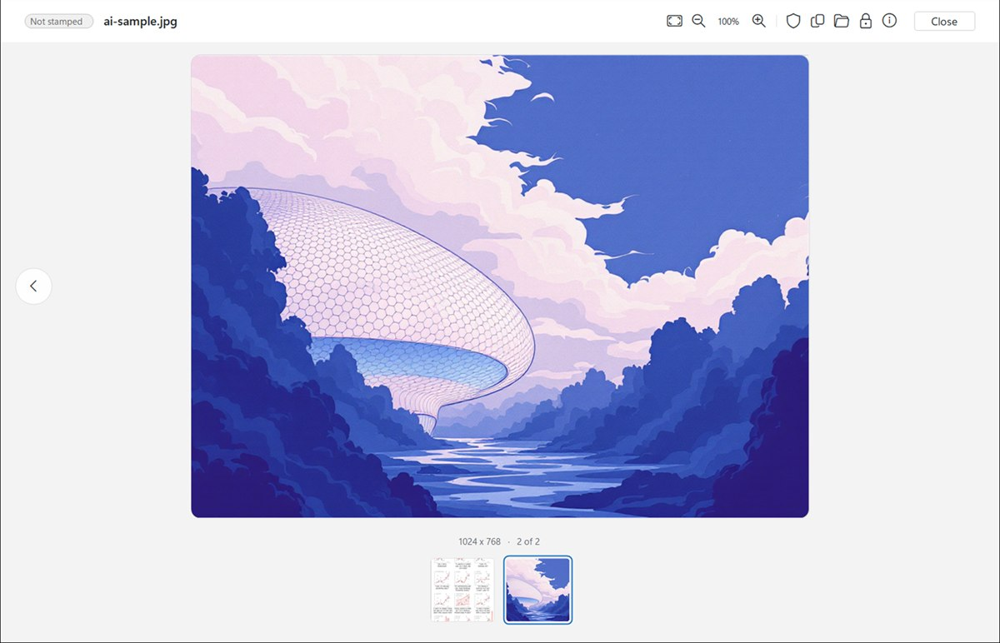
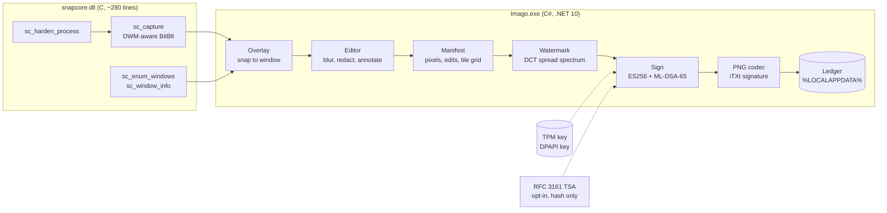
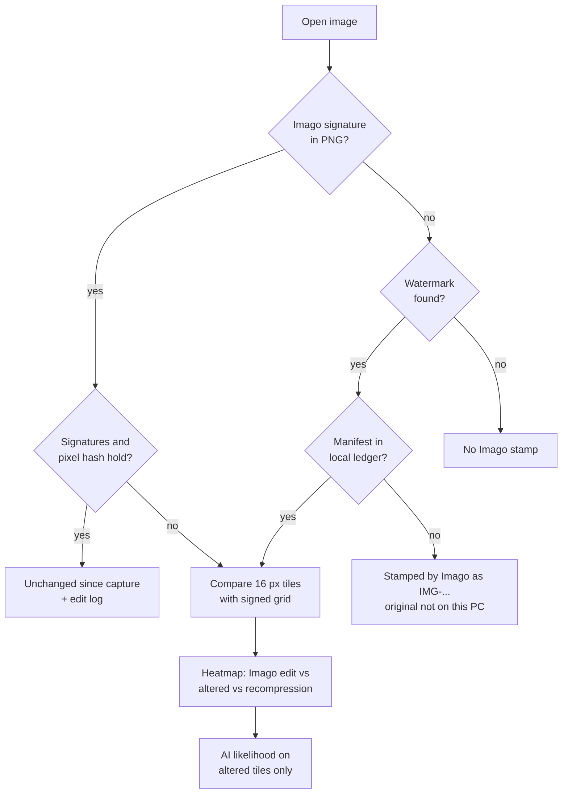

<p align="center">
  
</p>

<h1 align="center">Imago</h1>

<p align="center"><strong>Screenshots you can verify.</strong><br>
A Windows screenshot tool that signs what it captures, so anyone can later check whether an image was changed, where, and how.</p>

<p align="center">
  <a href="https://github.com/starkitekt/imago/actions/workflows/ci.yml"></a>
  <a href="LICENSE"></a>
  
  
</p>

<p align="center"></p>

---

## Why this exists

Screenshots are the most common evidence on the internet and the easiest to fake. A chat log, a dashboard,
a bank balance or an error message can be edited in seconds, and the result is indistinguishable from the
real thing. Generative fill has made it faster still.

Existing approaches each cover part of the problem:

- **Metadata signatures** (for example C2PA) prove an unmodified file, but disappear the moment a chat app
  recompresses the image or someone strips its metadata.
- **Watermarks** survive recompression but only identify an image. They cannot prove it is unchanged.
- **AI detectors** guess, and give no way to tell an honest redaction from a malicious edit.

Imago combines all three at the point of capture, on the device, with nothing uploaded.

## What it does

| | |
| --- | --- |
| **Capture** | Area, window, full screen or text (OCR). Files are named from context: `Inbox - Chrome - 2026-10-23 14.05.09.png`. |
| **Edit before saving** | Blur, redact, pen, highlight, arrows, boxes, text, numbered steps, crop. Auto-redact finds emails, phone numbers, card numbers, IP addresses, tokens and names with on-device OCR and covers them with solid boxes. The unedited pixels never touch disk. |
| **Stamp** | No visible mark. Each capture carries a signed manifest (ES256 and post-quantum ML-DSA-65) over the exact pixels, an invisible watermark that survives JPEG and rescaling, and a signed log of every edit made in Imago. |
| **Review** | Open any image and get four answers: changed or not, where (a tile heatmap), what kind (Imago edit, later alteration, or recompression), and how likely AI was involved, with the reasons. |
| **Lock with password** | Encrypt a capture to a `.snapseal` file with AES-256-GCM. |

A redacted screenshot can therefore be shared and still be proven genuine everywhere outside the redaction.

## Quick start

**Install.** Download `Imago-Setup-1.0.0.exe` from [Releases](https://github.com/starkitekt/imago/releases) and
check it against `SHA256SUMS.txt`. The installer is per-user and never asks for administrator rights. It needs
the [.NET 10 Desktop Runtime](https://dotnet.microsoft.com/download/dotnet/10.0); the `-standalone` build bundles it.

**Capture.**

| Keys | Capture |
| --- | --- |
| PrtSc, or Ctrl+Shift+4 | Area (hover snaps to windows, drag for a region, arrows nudge, Esc cancels) |
| Alt+PrtSc, or Ctrl+Shift+5 | Window |
| Ctrl+PrtSc, or Ctrl+Shift+3 | Full screen |
| Ctrl+Alt+PrtSc | Copy text from an area (OCR) |

If the Snipping Tool owns PrtSc, turn off *Use the Print screen key to open screen capture* in
Settings > Accessibility > Keyboard, or use the Ctrl+Shift keys.

**Review.** Open a `.png`, `.jpg` or `.snapseal` with Imago.

**Command line.** Everything the app does is scriptable, with stable exit codes:

```text
Imago.exe --capture full|window|area [--rect x,y,w,h] [--out dir]
          [--stamped] [--name "Name"] [--place "Place"] [--latlon lat,lon[,m]] [--use-location] [--tsa]
Imago.exe --verify  file.png        0 valid, 2 tampered, 3 unsigned, 4 error
Imago.exe --review  file.png|jpg    0 stamped, 1 resaved copy, 2 changed, 3 stamped elsewhere,
                                    4 forged, 5 not stamped, 6 error
Imago.exe --seal    file.png --password-stdin [--delete-original]
Imago.exe --unseal  file.snapseal --out dir --password-stdin
Imago.exe --key | --selftest | --version
```

Passwords are read from stdin only, never from arguments, so they do not land in shell history or process lists.

## Architecture

Two layers with a narrow boundary. A small C core owns everything that touches raw Win32 capture and process
hardening; the C# app owns imaging, cryptography, UI and review.



Review runs the same pipeline in reverse:



| Component | Files | Responsibility |
| --- | --- | --- |
| Native core | [`native/snapcore.c`](native/snapcore.c) | Capture, monitor and window geometry, runtime process mitigations. 9 exports, P/Invoke only. |
| Capture flow | `TrayApp`, `Overlay`, `Capture`, `Naming`, `QuickAccess` | Hotkeys, selection overlay, context-aware file names, preview. |
| Editor | `Editor`, `Marks`, `Ocr` | Annotation and redaction tools, auto-redact, signed edit log. |
| Provenance | `Provenance`, `Keys`, `Watermark`, `PngCodec` | Manifest, dual signatures, TSA, watermark, strict PNG reader and writer. |
| Review | `Review`, `AiModel` | Verdict, tile heatmap, change classification, AI likelihood (heuristics, optional ONNX model). |
| Lock | `Seal` | Authenticated encryption of captures. |
| UI | `Viewer`, `MainWindow`, `Dialogs`, `Controls`, `Fluent`, `Alert` | Fluent-style WinForms UI, Lato typeface embedded. |
| Tests | [`app/SelfTest.cs`](app/SelfTest.cs) | 39 end-to-end checks, shipped inside the exe. |

About 9,000 lines in total, with one third-party package (ONNX Runtime). Design notes for the Stamped format are
in [`docs/stamped.md`](docs/stamped.md).

## Security

The full threat model, adversary table and review findings are in
[**docs/security-model.md**](docs/security-model.md). In short:

**What a valid stamp proves.** These exact pixels came out of Imago on a device holding this key, with these
edits, at this time (trusted time if the RFC 3161 option was on). Changing one bit of one pixel, editing a
manifest field, cropping, removing either signature, or adding display chunks such as gamma or a colour
profile all read as **Tampered**. Stripping the metadata reads as **Unsigned**, never as valid.

**What it does not prove.** That what was on screen was true. Who the person is: the display name is typed,
and keys are not yet chained to a certificate authority. Location, which is what Windows reports.

| Purpose | Choice |
| --- | --- |
| Capture signature | ES256 (ECDSA P-256). Key created non-exportable in the TPM, software KSP fallback. |
| Post-quantum signature | ML-DSA-65 (FIPS 204, level 3). Seed protected with DPAPI. Both must verify. |
| Pixel binding | SHA-256 over a fixed label, width, height and RGB. Independent of PNG encoding. Fixed-time compare. |
| Trusted time | RFC 3161, opt-in. Only the signature hash leaves the PC. |
| Lock with password | AES-256-GCM, PBKDF2-SHA256 at 600,000 rounds, fresh salt and nonce, header authenticated. |

**Lock with password** rules, which must be preserved in any change:

- Passwords must be at least 8 characters.
- The key is derived with PBKDF2-SHA256 at 600,000 rounds.
- A wrong password and a modified file give the same error, so an attacker learns nothing from the difference.

**Untrusted input.** The viewer opens files from anywhere, so the PNG decoder is strict: CRC on every chunk,
64 MB chunk cap, 32,768 px per side, 1 GB pixel cap, exact inflate length, consecutive IDAT, no trailing data,
and an allow-list of chunk types inside signed files.

**Privacy.** No accounts, no telemetry, no network calls except the opt-in timestamp. OCR, place lookup and
AI review all run on the device.

Report vulnerabilities privately, see [SECURITY.md](SECURITY.md).

## Verification and quality gates

Every build, local or CI, runs [`build.ps1`](build.ps1), which fails on any of these:

| Gate | What it checks |
| --- | --- |
| Warnings as errors | C# (`TreatWarningsAsErrors`) and C (`-Werror -Wall -Wextra`). |
| Binary hardening | `llvm-objdump` confirms high-entropy ASLR, DYNAMICBASE, NX and Control Flow Guard on all four shipped binaries. The exe is also CET shadow-stack compatible. |
| Self-test | 39 checks against the published exe: lossless codec, signing, one-bit and crop tampering, stripped and duplicated signatures, Lock round trip and tamper, watermark after JPEG 85, review verdicts and localisation, the bundled ONNX runtime, file naming. |
| Supply chain | Deterministic build, one NuGet dependency, CI actions pinned by commit, `dotnet list package --vulnerable` clean, ONNX Runtime loaded by absolute path. |
| Release | `SHA256SUMS.txt` for every shipped file and a Microsoft Defender scan of the output. |

## Design decisions

**A C core for capture.** Capture and window geometry are thin Win32 calls where a managed wrapper adds
nothing but surface. Keeping them in under 300 lines of C, compiled with CFG, stack protector and fortify,
makes the native attack surface small enough to read in one sitting.

**Its own PNG codec.** A signature is only as good as the parser that reads it. A small, strict decoder with
explicit limits is easier to reason about than a general image library, and lets the signature cover an exact
allow-list of chunks.

**Two signatures.** ES256 gets hardware-backed keys today through the TPM. ML-DSA-65 protects captures that
may need to hold up in court years from now. Both must verify, and removing either is detected.

**Watermark and signature, not either.** Signatures authenticate but die in recompression. The watermark
survives but only identifies. Together, a recompressed copy can still be traced to its signed original and
compared tile by tile.

**Hash the pixels, not the file.** The canonical hash covers decoded RGB, so a lossless re-encode does not
break verification, while any visible change does.

**No bundled AI model.** Review works on built-in heuristics. A model is optional, runs locally from a folder
the user controls, and is never downloaded by the app. This keeps the install small and the trust surface
explicit.

**Offline timestamp validation.** The TSA certificate chain is checked without online revocation, so
verification is deterministic and works without a network. The trade-off is stated in the security model.

**Per-user install, no admin.** Nothing in the product needs elevation, so the installer never asks for it.

## Limitations and roadmap

- **Not code-signed yet.** SmartScreen warns on first run. Verify downloads with `SHA256SUMS.txt`.
- **Identity.** Keys are per device and self-issued. Next: C2PA manifests and certificate chaining.
- **Revocation.** There is no key revocation list yet.
- **Blur is visual, not cryptographic.** Use Redact (solid box) for secrets. Auto-redact already does.
- **Heavily cropped, rotated or re-photographed copies** may lose the watermark.
- **AI likelihood is a statistical reading,** never proof, and is labelled as such in the UI.
- **Windows only.** The core relies on DWM, TPM and Windows OCR.

## Build from source

Requirements: Windows 10 or 11, the [.NET 10 SDK](https://dotnet.microsoft.com/download/dotnet/10.0), and
[LLVM-MinGW](https://github.com/mstorsjo/llvm-mingw) (`winget install MartinStorsjo.LLVM-MinGW.UCRT`).
Inno Setup is optional and only needed for the installer.

```powershell
pwsh -NoProfile -File build.ps1                 # dist\Imago.exe, needs the .NET 10 Desktop Runtime
pwsh -NoProfile -File build.ps1 -SelfContained  # dist-standalone\, runtime bundled
dist\Imago.exe --selftest
```

## Repository layout

```text
app/          C# application (UI, imaging, crypto, review, self-test)
native/       C capture core (snapcore.dll)
installer/    Inno Setup script, per-user install
docs/         Security model, Stamped format, images
assets/       Logo and icon sources (SVG)
build.ps1     One-step build with hardening, self-test, checksums and scan
```

## Contributing

See [CONTRIBUTING.md](CONTRIBUTING.md). Changes to signing, the codec, the watermark or Lock need a self-test
check that fails without them.

## License

[MIT](LICENSE). Third-party components are listed in [THIRD-PARTY-NOTICES.md](THIRD-PARTY-NOTICES.md).
